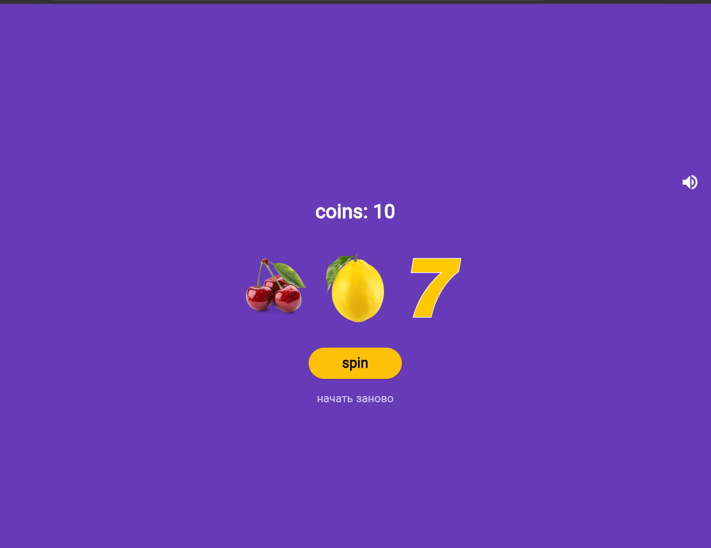

###### Лабораторная работа номер 10

###### Ульянов Владислав ИПС-243 13.10

#### Скриншоты готового приложения

Главный экран
!

Победа
[alt text](steps/win.png)|!

Проигрыш
[alt text](steps/win.png)|

### Установка
Скачайте готовый APK файл:
[text](build/app/outputs/flutter-apk/app-release.apk)

### Платформы и их версии
- Flutter 3.47.8
- Dart 3.13.7
- Платформы: Wed, Android

### Что изучили
- StatefulWidget и управление состоянием через setState()

- Работа с локальными изображениями через Image.asset()

- Генерация случайных чисел через dart:math

- Анимация через async/await и AnimatedOpacity

- Создание иконки в Крита и подключение через flutter_launcher_icons

- Сборка под Web и Android
