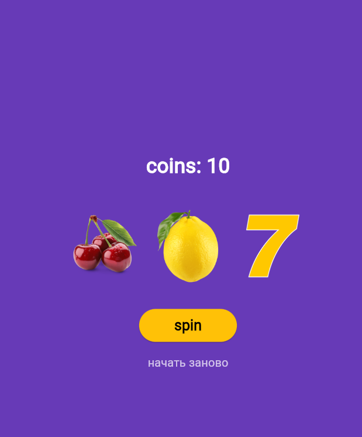

###### Лабораторная работа номер 9

###### Ульянов Владислав ИПС-243 13.10

##### Что изучили:

- Использование и создание кнопок и задние им параметров
- AnimatedSwitcher
- Duration

#### Скриншот готового приложения

### Запуск

- Скачать папку с приложением
- Запустить через vs/code
- Прописать в команде flutter run и выбрать ваш браузер
